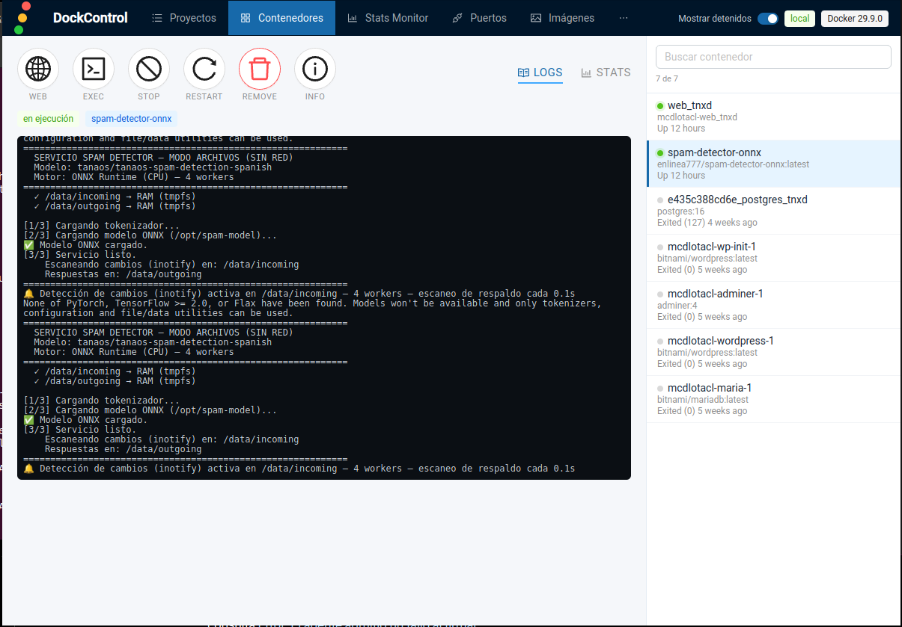

# DockControl

Aplicación de escritorio para administrar **Docker** (contenedores, imágenes,
proyectos Compose, monitor de estadísticas, puertos y conexiones). Reescritura
moderna inspirada en DockStation, construida con **Tauri 2 + Rust** y
**React 19**.



## Características

- **Contenedores**: lista con estado (verde en ejecución / gris detenido),
  acciones redondas (Web, Exec, Start/Stop, Restart, Remove, Info), consola de
  **logs** en vivo y **gráficas** de CPU, Memoria, IO de disco e IO de red.
- **Info**: árbol navegable con flechas a partir del `inspect` del contenedor.
- **Proyectos**: proyectos Compose (`docker compose ls/ps`), servicios,
  logs, editor de `docker-compose.yml` e importación desde `docker run`.
- **Stats Monitor**: tabla en vivo de contenedores con resumen del sistema
  (contenedores, running, CPU%, memoria usada), ordenable por columna, con
  selección por casillas.
- **Imágenes** y **Puertos**.
- **Conexiones**: contextos de Docker, hosts `unix://`, `tcp://`, `ssh://`,
  `npipe://` y conexiones guardadas.
- **Auto-conexión** al Docker local al iniciar (configurable en Preferencias).
- Ventana sin bordes con controles integrados y barra de menú arrastrable.

## Descarga

Los paquetes precompilados están en la página de **Releases**:

- **Linux**: `DockControl_<versión>_amd64.deb`, `DockControl-<versión>-1.x86_64.rpm`, `DockControl_<versión>_amd64.AppImage`
- **Windows**: `DockControl_<versión>_x64-setup.exe` (NSIS)
- **macOS**: `DockControl_<versión>_x64.dmg` (Intel) y `DockControl_<versión>_aarch64.dmg` (Apple Silicon)

## Instalación

### Debian / Ubuntu (.deb)

```bash
sudo dpkg -i DockControl_1.1.1_amd64.deb
sudo apt -f install   # resuelve dependencias si hiciera falta
```

### Fedora / RHEL / openSUSE (.rpm)

```bash
sudo rpm -i DockControl-1.1.1-1.x86_64.rpm
# o
sudo dnf install ./DockControl-1.1.1-1.x86_64.rpm
```

### AppImage (cualquier distribución Linux)

```bash
chmod +x DockControl_1.1.1_amd64.AppImage
./DockControl_1.1.1_amd64.AppImage
```

### Windows (.exe)

Ejecuta `DockControl_1.1.1_x64-setup.exe` y sigue el asistente.

> La aplicación **no está firmada** digitalmente. Windows SmartScreen puede
> avisar; pulsa "Más información" → "Ejecutar de todas formas".

### macOS (.dmg)

Abre el `.dmg` y arrastra DockControl a Aplicaciones.

> La aplicación **no está firmada/notarizada**. Al abrirla por primera vez,
> usa clic derecho → **Abrir** (o Ajustes de Sistema → Privacidad y seguridad →
> "Abrir de todas formas"). Elige el `.dmg` **x64** para Intel o **aarch64**
> para Apple Silicon.


## Compilar desde el código

Requisitos:

- Node.js 22+ y npm
- Rust (edition 2024) y Cargo
- Dependencias de Tauri en Linux (`webkit2gtk-4.1`, `gtk3`, `libsoup-3.0`)
- Docker instalado y en ejecución

```bash
npm install
npm run tauri dev            # desarrollo

npm run tauri build          # compilar binario y paquetes
# .deb      -> src-tauri/target/release/bundle/deb/
# AppImage  -> src-tauri/target/release/bundle/appimage/
```

## Versiones

| Versión | Fecha      | Notas |
| ------- | ---------- | ----- |
| 1.1.1   | 2026-10-14 | Detección del host Docker según el SO (Windows `npipe://`, macOS/Linux `unix://`) con fallbacks; gráficas de stats con cuadrícula y ejes; iconos originales de DockStation. Releases multi-plataforma: `.deb`, `.rpm`, `.AppImage` (Linux), `.exe` (Windows), `.dmg` (macOS x64 y arm64). |
| 1.0.0   | 2026-10-14 | Primera versión. Contenedores, imágenes, proyectos Compose, monitor de estadísticas, puertos, conexiones, auto-conexión local. Paquetes `.deb` y `.AppImage`. |

## Tecnologías

- Tauri 2 (Rust edition 2024)
- React 19 + antd 6 + react-router 7 + zustand
- bollard (Docker API) y CLI de Docker Compose v2

## Licencia

Este proyecto se distribuye bajo la **GNU General Public License v3.0 o
posterior** (GPL-3.0-or-later). Ver el archivo [LICENSE](LICENSE).
